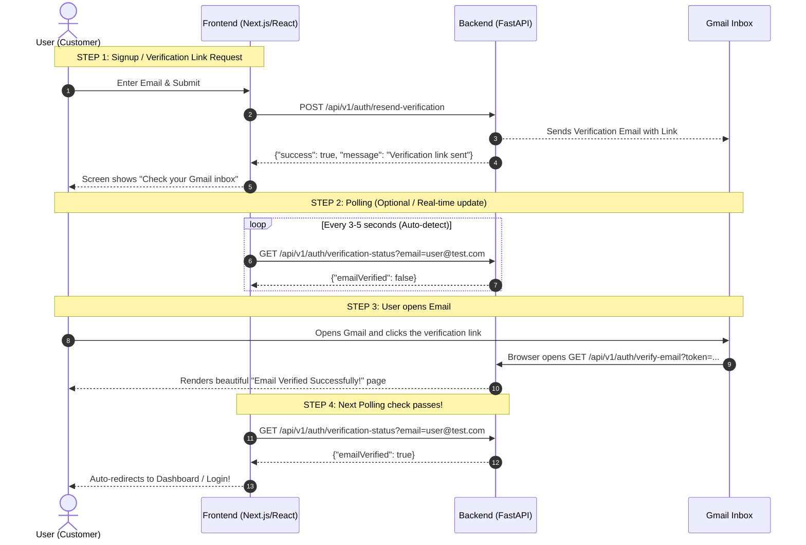

# 📘 Complete Guide: Email Verification & Password Reset APIs

Is document mein **Email Verification** aur **Password Reset** se judi saari APIs ko bilkul aasan bhasha mein samjhaya gaya hai — taaki Frontend aur Backend integration mein koi confusion na rahe.

---

## 🎯 Quick Summary: Kisko Konsi API Call Karni Hai?

Agar aap **Frontend (React / Next.js)** bana rahe hain, toh aapko sirf **ye 3 APIs** call karni hain:

| Task / Feature | API Endpoint | Method | Body / Params |
| :--- | :--- | :--- | :--- |
| **Link bhejna** | `/api/v1/auth/resend-verification` | `POST` | `{"email": "user@example.com"}` |
| **Status check karna** | `/api/v1/auth/verification-status?email=...` | `GET` | Query param: `email` |
| **Custom Frontend verify page se verify karna** | `/api/v1/auth/verify-email` | `POST` | `{"token": "..."}` ya `{"link": "..."}` |

> **Note:**
> **GET `/api/v1/auth/verify-email`** aur **GET `/api/v1/auth/reset-password`** frontend code ko call **nahi** karni hoti! Wo direct browser ke liye hain jab user Gmail mein link par click karta hai.

---

## 🔄 End-to-End Visual Flow (Kaise kaam karta hai?)



---

## 📑 Har API Ka Detailed Kaam (Deep-Dive)

### 1. Verification Link Bhejna
* **Endpoint:** `POST /api/v1/auth/resend-verification`
* **Alternative Alias:** `POST /api/v1/auth/send-verification` *(Dono ek hi kaam karte hain)*
* **Request Body:**
  ```json
  {
    "email": "user@gmail.com",
    "force": true
  }
  ```
* **Response:**
  ```json
  {
    "success": true,
    "message": "Verification link has been sent to your Gmail inbox.",
    "data": {
      "email": "user@gmail.com",
      "emailSent": true,
      "isVerified": false
    }
  }
  ```
* **Kyu banayi:** Jab user signup karta hai ya screen par *"Resend Verification Link"* button dabata hai, tab is API ko call kiya jata hai.

---

### 2. Browser Verification (Gmail Click)
* **Endpoint:** `GET /api/v1/auth/verify-email?token=xyz` (ya `?link=http://...`)
* **Kiske liye hai:** **Sirf Browser / Gmail ke liye.**
* **Ye kya karti hai:**
  * Jab user Gmail mein link click karta hai, browser direct is URL ko kholta hai.
  * Backend user ko MongoDB mein `emailVerified: True` mark kar deta hai.
  * User ke samne ek modern dark-theme HTML screen khulti hai jisme likha hota hai:
    > **✓ Email Successfully Verified!**
    > Button: *Proceed to Login*

---

### 3. Frontend App Verification (JSON API)
* **Endpoint:** `POST /api/v1/auth/verify-email`
* **Kiske liye hai:** **Frontend Developer ke React/Next.js Code ke liye.**
* **Request Body:**
  ```json
  {
    "token": "YOUR_JWT_VERIFICATION_TOKEN"
  }
  ```
  *(Aap full link bhi bhej sakte hain: `{"link": "http://127.0.0.1:8000/api/v1/auth/verify-email?token=..."}`)*
* **Response:**
  ```json
  {
    "success": true,
    "message": "Email verified successfully",
    "data": {
      "email": "user@gmail.com",
      "emailVerified": true,
      "isVerified": true
    }
  }
  ```
* **Kyu banayi:** Agar aap chahte hain ki Gmail ka link aapke Frontend domain pe khule (jaise `https://myapp.com/verify?token=...`) aur aapka Frontend page khud background mein backend ko request bheje, tab ye POST API use hoti hai.

---

### 4. Verification Status Check (Polling)
* **Endpoint:** `GET /api/v1/auth/verification-status?email=user@gmail.com`
* **Alternative:** `POST /api/v1/auth/verification-status` *(JSON body: `{"email": "user@gmail.com"}`)*
* **Response:**
  ```json
  {
    "success": true,
    "email": "user@gmail.com",
    "emailVerified": true,
    "isVerified": true
  }
  ```
* **Kyu banayi:** Jab user ke samne screen aati hai *"Please check your inbox"*, frontend har 3-4 second mein ye API call karke check karta rehta hai. Jaise hi user ne phone ya tab mein email link click kiya, frontend ko pata chal jata hai aur wo user ko bina reload kiye turant login/dashboard pe bhej deta hai.

---

### 5. Forgot Password & Reset Password

| Endpoint | Method | Kiske liye? | Kya karta hai? |
| :--- | :--- | :--- | :--- |
| `/api/v1/auth/forgot-password` | `POST` | Frontend App | User ka email le kar Gmail par Password Reset link bhejta hai. |
| `/api/v1/auth/reset-password` | `GET` | Browser / Gmail Click | Gmail link click karne par "Enter New Password" wala sundar form kholta hai. |
| `/api/v1/auth/reset-password` | `POST` | Form / Frontend App | Naya password (`newPassword` + `confirmPassword`) database mein update karta hai. |

---

## 💻 Frontend Integration Code (Example)

### Example 1: Resend Verification Link
```javascript
async function resendVerificationLink(email) {
  const res = await fetch("http://127.0.0.1:8000/api/v1/auth/resend-verification", {
    method: "POST",
    headers: { "Content-Type": "application/json" },
    body: JSON.stringify({ email: email, force: true })
  });
  return await res.json();
}
```

### Example 2: Auto-check Status (Polling)
```javascript
function pollVerificationStatus(email, onVerified) {
  const interval = setInterval(async () => {
    try {
      const res = await fetch(`http://127.0.0.1:8000/api/v1/auth/verification-status?email=${encodeURIComponent(email)}`);
      const data = await res.json();
      if (data.emailVerified) {
        clearInterval(interval);
        onVerified(); // Auto redirect to dashboard!
      }
    } catch (err) {
      console.error("Polling error:", err);
    }
  }, 3000); // Check every 3 seconds
}
```

---

## ❓ Common Questions & Doubts

**Q1: Mujhe do-do verify APIs kyu dikh rahi hain (GET aur POST)?**
* **Answer:** Kyunki email client (Gmail) sirf `GET` request bhej sakta hai jab user link click karta hai. Jabki modern JavaScript apps `POST` request bhejti hain JSON data ke sath. Isliye dono tareeqon ko support karne ke liye dono endpoints banaye gaye hain.

**Q2: Kya mujhe sabhi APIs integrate karni padengi?**
* **Answer:** Bilkul nahi! Aapko sirf:
  1. Signup ke baad link bhejna (`/resend-verification`)
  2. Status check karna (`GET /verification-status`)
  Bas! Baaki ka kaam browser aur backend khud sambhal lete hain.
